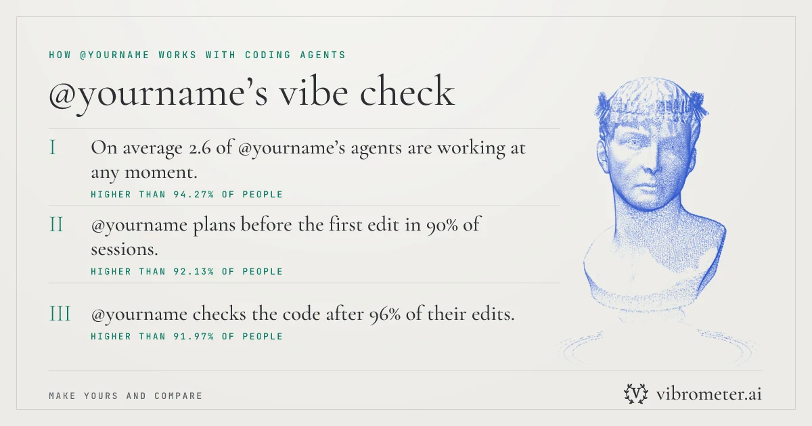

# Vibrometer for Claude Code

**See how you work with coding agents.** Vibrometer reads the Claude Code and Codex sessions you choose and shows the
habits where you differ most from other developers, each as a percentile: how often you plan before the first edit,
check the agent's changes, say what done looks like, correct it, or run agents in parallel. It also runs the
Olympiad, timed AI-coding challenges graded with hidden tests. Free, at **[vibrometer.ai](https://vibrometer.ai)**.

This is its plugin for Claude Code. Vibrometer is made by Sieve Data Inc. It isn't Vibemeter or Vibe Meter, which
are other people's AI spending trackers.

## Install

In Claude Code:

```
/plugin marketplace add usesieve/vibrometer-plugin
/plugin install vibrometer@vibrometer
/vibrometer:analyze
```

No plugin? Drag your `~/.claude/projects` or `~/.codex/sessions` folder onto
[vibrometer.ai](https://vibrometer.ai/#analyze): the analysis runs in your browser.

## What you get

The first summary, worked out on your computer from your own logs (this one is from two sample sessions):

```text
╭──────────────────────────────────────────────────────────────────────────────────╮
│                      ,(\(\(   V I B R O M E T E R   )/)/),                       │
│                                  know thy vibe                                   │
│                                                                                  │
│  Read 2 conversations and 10 prompts from Claude Code and Codex, from the last   │
│  30 days, on this computer.                                                      │
│                                                                                  │
├─ Where you stand out ────────────────────────────────────────────────────────────┤
│                                                                                  │
│  1  Your agents use 26k tokens for each session that ends verified               │
│     ─●────────────┼─────────────  Lower than 97.85% of people                    │
│                                                                                  │
│  2  100% of your coding sessions end with passing checks or a commit after the   │
│     last edit                                                                    │
│     ──────────────┼───────────●─  Higher than 94.71% of people                   │
│                                                                                  │
│  3  40% of your prompts are sent after 11pm                                      │
│     ──────────────┼──────────●──  Higher than 92.65% of people                   │
╰──────────────────────────────────────────────────────────────────────────────────╯
```

Your vibe check adds every habit with its percentile, a vibe type (a short AI-written description of how you work),
your vibes wrapped (hours, tokens, cost at API list prices, busiest day) and a card to share:

<picture>
  <source media="(prefers-color-scheme: dark)" srcset="assets/vibe-check-card-dark.webp">
  
</picture>

## Commands

| Command | What it does |
| --- | --- |
| `/vibrometer:analyze [--days 30]` | Your vibe check: lists your conversations, you pick which count, and nothing is uploaded until you confirm. Ask for a private check and only numbers are sent. |
| `/vibrometer:login` | Sign in by approving this computer on vibrometer.ai. |
| `/vibrometer:challenge <name>` | Read the ticket of an Olympiad challenge. The clock doesn't start yet. |
| `/vibrometer:start` | Start the clock and get the starter files. |
| `/vibrometer:ask "<question>"` | Ask the challenge's stakeholder one of your few questions. |
| `/vibrometer:update` | Fetch the follow-ups that arrive partway through a challenge. |
| `/vibrometer:submit` | Grade your solution with hidden tests and post it to the leaderboard. |

## Your data

You choose every conversation that counts, and nothing is uploaded until you confirm the selection and the upload
statement. A private check sends only numbers, never your prompts or code. Shared vibe checks show your handle,
habits and percentiles, never your conversations, code, or project and file names. Details:
[How it works](https://vibrometer.ai/methodology) and the [privacy policy](https://vibrometer.ai/privacy).

## More

- [How to see your Claude Code usage stats](https://vibrometer.ai/guides/claude-code-usage-stats)
- [Claude Code analytics tools, compared](https://vibrometer.ai/guides/claude-code-analytics-tools)
- [Vibrometer vs ccusage](https://vibrometer.ai/guides/vibrometer-vs-ccusage)
- [AI-coding leaderboards](https://vibrometer.ai/leaderboard) and [challenges](https://vibrometer.ai/challenges)

Plugin version 0.3.1. This repository is generated from the main Vibrometer repository; changes made here are
overwritten. Questions: hello@vibrometer.ai.
